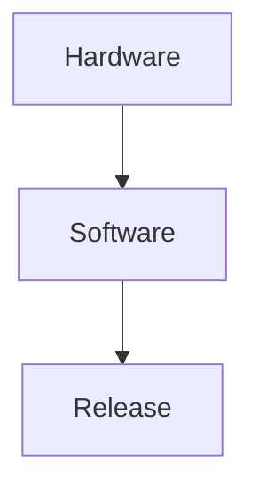

## Overview

Bryce Arce provides powerful tools to organize, collaborate on, and manage your project documentation. You can create structured spaces for technical specs, guides, and appendices, with features like outlines, sharing, and advanced editing. Use it to streamline workflows from initial drafts to final releases.

<Columns cols={2}>
  <Card title="Project Organization" icon="folder" href="/guides/organization">
    Structure your docs with folders, tabs, and outlines for easy navigation.
  </Card>
  <Card title="Collaboration" icon="users" href="/authentication">
    Share securely and track changes with real-time editing.
  </Card>
  <Card title="Editing Tools" icon="edit-3" href="/quickstart">
    Rich text editing with support for images, code, and appendices.
  </Card>
  <Card title="Search & Outlines" icon="search" href="/configuration">
    Quickly find content using powerful search and dynamic outlines.
  </Card>
</Columns>

## Project Organization Tools

Organize complex projects using folders, document tabs, and outlines. Create hierarchies for appendices, hardware specs, and software releases. Outlines automatically generate from headings, helping you navigate large documents.

<Board title="Documentation Workflow">
  <BoardColumn title="Draft" color="0" icon="edit">
    <BoardCard title="Create Outline" description="Add headings for structure" icon="list" />
    <BoardCard title="Hardware Specs" description="Document Figure 3 details" dueDate="2024-12-15" />
  </BoardColumn>
  <BoardColumn title="Review" color="1" icon="eye">
    <BoardCard title="Share for Feedback" description="Invite collaborators" icon="share-2" author="Team Lead" />
  </BoardColumn>
  <BoardColumn title="Publish" color="2" icon="check-circle">
    <BoardCard title="Final Release" description="Export or embed" createdAt="2024-12-20" />
  </BoardColumn>
</Board>

## Collaboration and Sharing

Invite team members to edit documents in real-time. Track changes, add comments, and manage permissions. Secure sharing ensures only authorized users access sensitive project details.

<Tabs>
  <Tab title="Internal Team" icon="users">
    Share via links with edit or view access. Use version history to revert changes.
  </Tab>
  <Tab title="External Review" icon="external-link">
    Generate public read-only links for stakeholders. Set expiration dates for temporary access.
  </Tab>
</Tabs>

<Callout kind="tip">
  Always review change logs before approving major edits to maintain document integrity.
</Callout>

## Document Editing Features

Edit with a rich interface supporting text, images, code blocks, and tables. Insert figures for hardware specs or software diagrams. Use tabs for multi-section documents like appendices.

<Steps>
  <Step title="Start Editing" icon="edit-3">
    Open a new document and add headings for automatic outline generation.
  </Step>
  <Step title="Insert Media">
````markdown
Add images or code:



````
  </Step>
  <Step title="Save and Share" icon="share-2">
    Click Share to invite collaborators.
  </Step>
</Steps>

## Search and Outlines

Search across all documents with keyword matching. Outlines provide a live table of contents, jumping to sections instantly. Filter by appendices or resource persons.

<Expandable title="Advanced Search Tips" default-open="true">
  Use quotes for exact phrases: `"Figure 3"`. Combine with filters for resource changes.
</Expandable>

<CodeGroup tabs="API,CLI">
````javascript
// Embed search in your app
const docs = await fetch('https://api.example.com/docs/search?q=appendix');
console.log(docs.json());
````
````bash
# CLI search
bryce search "hardware specs" --project myproject
````
</CodeGroup>

These features make Bryce Arce ideal for technical documentation, ensuring your projects stay organized and accessible. Explore [quickstart](/quickstart) for hands-on setup.